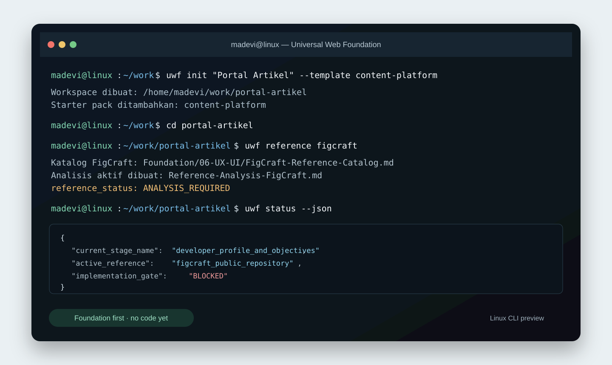

# Universal Web Foundation

Current stable version: [1.2.0](https://github.com/Madevi810/Universal-Web-Foundation/releases/tag/v1.2.0)

Universal Web Foundation (UWF) is an open-source, AI-ready planning and governance workspace for web projects. It helps a developer and an AI agent turn an idea into an approved web implementation without forcing a fixed stack, provider, or level of experience.

UWF is for websites, web applications, dashboards, SaaS, commerce, content platforms, browser games, and mixed platforms. It is not a native iOS, Android, desktop, or embedded-app framework.

## What UWF does

- Adapts questions and recommendations for beginner, intermediate, and professional developers.
- Supports either full AI guidance or AI recommendations with a complete choice list and a custom-answer option.
- Builds a Foundation in safe stages: objectives, users, project mode, modules, MVP, UX/UI, architecture, operations, and quality.
- Prevents implementation from starting until the relevant stage is analyzed and approved.
- Supports prototype-local, prototype-online, beta, and production-online modes.
- Plans a controlled migration from prototype to online production while retaining the archived prototype foundation.
- Supports optional automation with explicit scope, budgets, quality gates, logs, rollback, and a kill switch.
- Records change requests and impact analysis when forgotten features or new objectives appear during or after implementation.
- Provides an optional UI/UX creative brief, responsive review, and controlled image/HTML simulation planning.
- Includes machine-readable CLI context, status, next-step, and validation output for terminal AI agents.
- Uses an original capability matrix, starter Foundation packs, reference-analysis record, plugin disclosure, and release-readiness process.
- Treats stacks, patterns, quality controls, content systems, and operational choices as composable engineering materials with compatibility, lifecycle, and evidence records.
- Adds controlled external-reference research and a post-Foundation Research, Content & Production workflow for taxonomy, source-led content, quality review, and publication planning.

## Quick start

After installing the CLI, run:

```bash
uwf
```

The interactive flow asks for a project name and creates a workspace. Advanced users may use:

```bash
uwf init nama-web
```

Or start with an original Foundation pack:

```bash
uwf template list
uwf init nama-web --template content-platform
```

Open the generated workspace in an AI coding environment and ask the agent to read `AGENTS.md` and `FOUNDATION_MANIFEST.yaml` first.

For terminal AI agents, use:

```bash
uwf context --json
uwf status --json
uwf next --json
uwf validate --json
```

## Workspace lifecycle

```text
Discovery and Foundation
  -> stage analysis
  -> developer approval
  -> implementation of an approved stage
  -> review and change analysis
  -> next stage, upgrade, or release
```

The template starts with `Project-Implementasi/` locked for application code. When the implementation gate is approved, use `uwf approve implementation --project "Nama Web"` to rename it to `Project-Nama-Web/` and create a minimal implementation skeleton.

UWF may learn from public UI/UX references, but its Foundation packs, UI guidance, assets, and code remain original. Use `uwf reference` to follow the clean-room reference-analysis workflow in Foundation/06-UX-UI.

For broader engineering or content research, UWF records the source policy and evidence before making a recommendation. The installed CLI does not pretend to be a search engine: a web-capable AI agent must declare its available access and operate only within the developer-approved scope.

## See UWF in use

### Linux terminal CLI



The CLI creates and checks a Foundation workspace. It records decisions and blocks implementation when a required review has not been completed.

### AI coding workspace


Open the generated workspace in any AI-capable coding environment. The agent reads `AGENTS.md`, `FOUNDATION_MANIFEST.yaml`, and the active Foundation stage before it recommends or implements work.

These previews are original UWF illustrations. They show the intended workflow and are not screenshots or copies of a branded terminal, IDE, or external design tool.

## Important documents

| File | Audience | Purpose |
| --- | --- | --- |
| `README.md` | Humans | Installation and high-level usage |
| `AGENTS.md` | AI agents | Mandatory operating rules |
| `FOUNDATION_MANIFEST.yaml` | Humans and agents | Current machine-readable project state |
| `Foundation/` | Humans and agents | Decisions, questions, analysis, reports, and handover |

## Installation from GitHub

```bash
curl -fsSL https://raw.githubusercontent.com/Madevi810/universal-web-foundation/main/scripts/install.sh -o install-uwf.sh
less install-uwf.sh
bash install-uwf.sh
```

The installer uses no root access and installs the newest stable release into `~/.local/bin`. It needs `bash`, `curl`, and `git`. Use `--edge` only when intentionally testing the moving main branch.

## Open-source scope

UWF is deliberately provider-neutral. Git, GitHub, Docker, hosting providers, databases, payment services, content automation, and AI providers are optional integrations. The core Foundation works offline after installation.

See [Foundation/README.md](Foundation/README.md) for the Foundation map and [docs/beginner/START-HERE.md](docs/beginner/START-HERE.md) for the beginner path.
