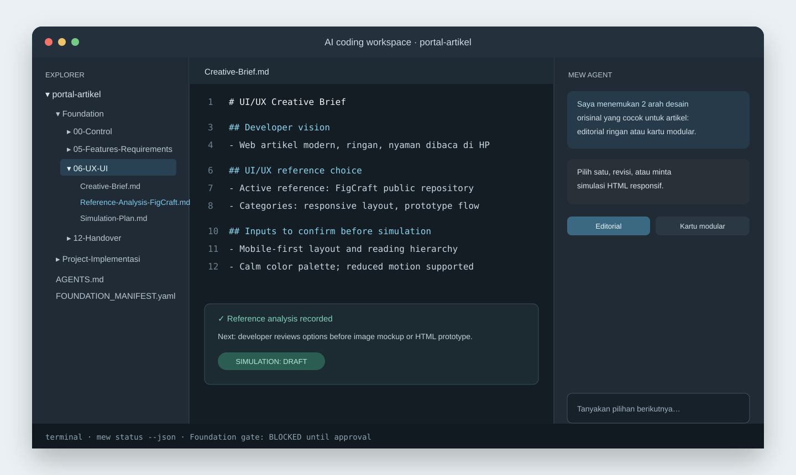

# Madevi Engineer Website

Current stable release: [v2.0.0](https://github.com/Madevi810/Madevi-Engineer-Website/releases/tag/v2.0.0)
Development on `main`: post-v2.0.0 maintenance and future improvements

The current development patch strengthens implementation gates, migration snapshots, and automation controls. It remains under review until a new tagged release is published.

Madevi Engineer Website (MEW) is an open-source engineering foundation for **web projects**. It helps an AI agent turn a developer's ordinary-language idea into a reviewed, traceable, and implementation-ready Foundation.

MEW is not a website builder, design editor, chatbot replacement, or a collection of copied boilerplates. It is the operating system around an AI coding workflow: it gives the agent materials, rules, tools, evidence, quality gates, and an accountable way to work.

It supports websites, web applications, dashboards, SaaS, marketplaces, article/media platforms, browser games, and mixed multi-module platforms. Native mobile, desktop, and embedded applications are outside the core scope.

## The simple idea

The developer should not need to become a system architect or answer a giant form.

```text
Developer explains the goal in plain language
          ↓
MEW Agent understands the goal and makes safe assumptions
          ↓
It selects materials, skills, tools, strategy, and project stages
          ↓
It asks only the few questions that need a human decision
          ↓
It shows status, risks, options, and a confirmation gate
          ↓
Approved work moves to implementation
```

For example, a developer may say: “I want an Indonesian space article website that can later add learning products.” The agent independently prepares modules, taxonomy, stack options, rights/source policy, mobile UX, growth path, and risk notes. It then asks only material questions such as prototype versus online, language scope, or whether real payments are required.

## What MEW provides

- Progressive Foundation planning for beginner, intermediate, and professional developers.
- Full-agent recommendation mode or recommendation with a complete/custom choice path.
- Engineering Material Library: stack, architecture, data, UX, security, testing, operations, content, and migration decisions.
- One orchestrating agent with specialist roles for product, architecture, UX/UI, research, taxonomy, content, quality, migration, and operations.
- Tool contracts, capability detection, permission gates, dry-run workflow, action journal, and job records.
- Evidence Cards for GitHub, official documentation, factual sources, creative references, licenses, rights, and freshness limits.
- Prototype-local, prototype-online, beta, and production-online paths.
- Controlled content planning from 1 item to 10,000+ items with batch, quality, rights, capacity, and publishing controls.
- Change Requests for forgotten features or altered goals after implementation has begun.
- HTML/image simulation planning, responsive/accessibility review, and clean-room UI reference analysis.
- Machine-readable status, validation, agent routing, tool, job, and evaluation output for terminal AI agents.

## What MEW does not promise

MEW does not claim every AI runtime has web search, GitHub access, a browser, image generation, cloud credentials, or publishing authority. The Runtime Profile records what is actually available. An unavailable tool must be reported, never invented.

MEW supplies instructions and local workflow tools; it does not include an AI model or guarantee a particular model's reasoning. The tool runner primarily records dry-run plans. Web search, GitHub research, scheduling, content generation, and publication need an external runtime or adapter. Gate checks verify selected fields and files, but cannot determine whether a plan is substantively correct; the developer and agent must review it.

MEW also never treats a public repository, video, book, image, social post, or design reference as permission to copy it. It records licenses, limits, evidence, and original-use rules first.

For the current patch evaluation and remaining engineering work, see [docs/EVALUATION-2.0.1.md](docs/EVALUATION-2.0.1.md).

## Agent workflow

The Foundation Orchestrator is the only agent that speaks for the whole system. Specialist agents are roles it selects internally; they do not send disconnected questions to the developer.

| Role | Main responsibility |
| --- | --- |
| Foundation Orchestrator | Understands goals, routes work, controls questions, stages, and approvals |
| Product & Discovery | Users, MVP, modules, objectives, and success measures |
| Engineering Composer | Selects compatible materials, alternatives, costs, and risks |
| Architecture & Stack | Frontend, backend, data, API, identity, integration, and migration |
| UX/UI | Information hierarchy, responsive behavior, accessibility, simulation |
| Research & Evidence | Approved external research, GitHub review, source verification, provenance |
| Taxonomy & Content | Categories, metadata, content map, batch plan, rights, and quality queue |
| Quality, Security & Rights | Tests, security, privacy, accessibility, licenses, and release evidence |
| Migration & Operations | Change impact, prototype-to-online, capacity, deployment, rollback |
| Automation Supervisor | Approved jobs, budget, audit, rollback, and kill switch |

### When the agent asks a question

By default it makes safe, visible assumptions. It asks at most three high-value questions at one time, only when the answer changes the objective, budget, legal/rights position, security, real-user data, provider choice, publishing, deployment, or an already-approved decision.

Every meaningful stage ends with a compact report:

```text
Stage: Content Foundation
Status: READY WITH NOTES
Designed: taxonomy, source policy, 10-item pilot batch, mobile UX, growth path
Assumptions: beginner audience, Indonesian-first, no account system in MVP
Need from developer: prototype or online?
Recommendation: online prototype with managed content storage
Choices: approve / edit assumption / add goal / defer
```

## Workspace lifecycle

```text
Discovery
→ Foundation composition
→ stage analysis and validation
→ developer approval
→ Project-Name-Project implementation
→ review, change request, migration, or release
→ optional controlled content operations
```

Application code is locked while the Foundation is being prepared. After the relevant gate is approved, `Project-Implementasi/` becomes `Project-Name-Project/`.

## Install

Linux requirements: `bash`, `curl`, and `git`.

```bash
curl -fsSL https://raw.githubusercontent.com/Madevi810/Madevi-Engineer-Website/main/scripts/install.sh -o install-mew.sh
less install-mew.sh
bash install-mew.sh
```

The installer needs no root access and installs the newest stable tagged release into `~/.local/bin`. Use `--edge` only to intentionally test the moving `main` branch.

## Start a project

```bash
mew init Name-Project
cd name-project
mew context --json
mew status --json
```

Optional Foundation packs:

```bash
mew template list
mew init Name-Project --template content-platform
```

Open the generated workspace in an AI coding environment. Ask the agent to read `AGENTS.md`, `FOUNDATION_MANIFEST.yaml`, the active Foundation stage, and the current status before acting.

## Tool runtime

MEW tools are provider-neutral. Their contracts define capability, permission, input/output, dry-run behavior, logs, approval, rollback, and fallback.

```bash
mew tool list
mew tool doctor
mew tool capability
mew tool inspect workspace-inspector
mew tool run workspace-inspector --dry-run
mew agent status
mew agent route
mew job list
mew evaluation run regression
```

The default local tools analyze the workspace and create traceable planning records. External tools such as GitHub research, web search, deployment, databases, and publishing require a matching available adapter and the relevant policy/approval.

## Key commands

| Command | Purpose |
| --- | --- |
| `mew status --json` | Machine-readable Foundation state |
| `mew next --json` | Current stage and next safe action |
| `mew validate --json` | Validate Foundation readiness |
| `mew compose plan` | Open the engineering Composition Manifest |
| `mew material assess` | Begin material and compatibility review |
| `mew evidence add "Name"` | Record external evidence without copying it |
| `mew research prepare` | Prepare research policy and plan; does not search by itself |
| `mew taxonomy plan` | Plan hierarchy and metadata |
| `mew operations prepare` | Prepare controlled content operations after implementation approval |
| `mew change new "Title"` | Record a forgotten feature or scope change |
| `mew approve implementation --project "Name-Project"` | Activate `Project-Name-Project/` after gates pass |

## Safety model

| Action | Default behavior |
| --- | --- |
| Read/analyze local Foundation | Allowed |
| Create Foundation plans and dry-runs | Allowed |
| Use unavailable web/GitHub/browser access | Blocked and reported honestly |
| Add dependencies | Requires compatibility, license, and security review |
| Write application code | Requires implementation gate approval |
| Push, deploy, publish, or use real-user data | Requires explicit developer approval and applicable policy |
| Schedule autonomous work | Requires scope, budget, quality gate, rollback, audit log, and kill switch |

## Visual workflow

### Linux terminal CLI


### AI coding workspace



These are original MEW illustrations, not screenshots or copies of a branded IDE, terminal, or external design tool.

## Important files

| File/folder | Purpose |
| --- | --- |
| `AGENTS.md` | Mandatory operating rules for AI agents |
| `FOUNDATION_MANIFEST.yaml` | Current machine-readable project state |
| `Foundation/` | Project decisions, materials, evidence, stages, and handover |
| `agent/` | Orchestrator routing, assumption, question, status, and escalation rules |
| `skills/` | Specialist role instructions and workflows |
| `tools/` | Tool contracts, local runner, adapters, validators, and safety rules |
| `policies/` | Permission, data, research, publishing, automation, and runtime policies |
| `evaluations/` | Scenarios, negative tests, regression, and expected artifacts |
| `Project-Name-Project/` | Application implementation after approval |

## Open source and contribution

MEW remains provider-neutral and open source. Git, GitHub, Docker, hosting, databases, payment providers, content automation, AI models, and cloud services are optional integrations. The core Foundation works offline after installation.

Read [Foundation/README.md](Foundation/README.md) for the Foundation map, [docs/beginner/START-HERE.md](docs/beginner/START-HERE.md) for the beginner path, and [CONTRIBUTING.md](CONTRIBUTING.md) to contribute safely.
